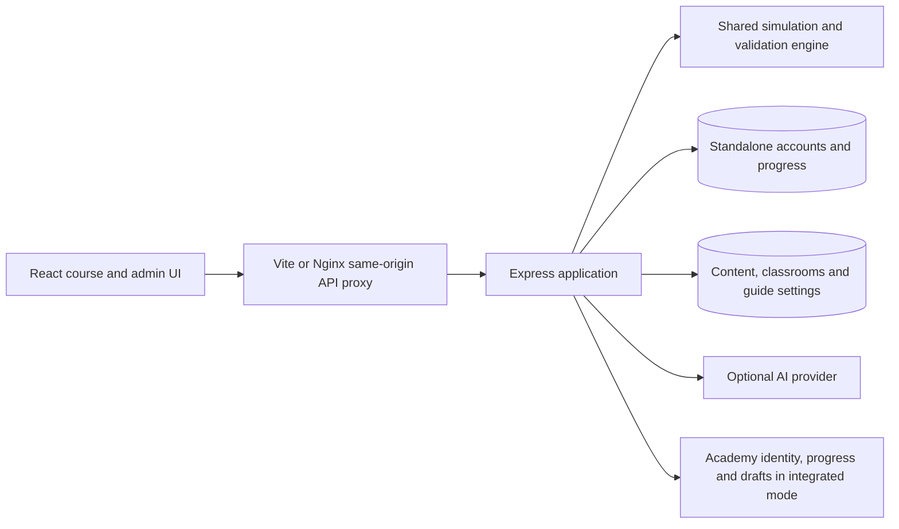

# FLAMES architecture

FLAMES is an npm workspace with three packages and stable public route/protocol boundaries. See the [repository map](REPOSITORY_STRUCTURE.md) for source ownership and the [application flow](APPLICATION_FLOW.md) for user-visible behavior.

## Package and runtime boundaries

The engine owns pure ordered policy decisions, matching, native task definitions, PAN models, authored-content/configuration contracts, progress/draft validation and deterministic learning hints. Its source is grouped into policy, interfaces, ports, PAN, content, progress, learning, evaluator and scenario folders. `src/index.ts` remains the public export boundary. The backend loads compiled CommonJS from `dist/index.js`; Vite consumes the TypeScript browser entry. Rebuild shared output when running the backend independently; `npm run backend:dev` supervises both packages.

The backend constructs dependencies in `app.ts` and starts in `server.ts`. Feature folders own content, classroom, draft, identity/integration and migration responsibilities. Native training routes/controllers use shared grading and scenario registries. Frontend pages own vendor-specific console interactions; shared shells, API helpers, draft state, course metadata and hardware utilities avoid duplicating cross-vendor behavior.

Vite forwards same-origin `/api` requests during development. Production Nginx serves the SPA/assets and proxies API requests. Only configured origins are accepted for cross-origin use and mutating requests; provider credentials never belong in browser environment variables.

## Identity and persistent state

| Responsibility | Standalone mode | Academy mode |
| --- | --- | --- |
| Student identity | Local user/session store | Verified parent identity; bearer stays in memory |
| Completion | Account SQLite; device-local for guests | Authenticated parent progress API |
| Simulator drafts | Account SQLite or guest local storage | Parent MySQL adapter |
| Authored content, revisions and guide settings | FLAMES content SQLite | FLAMES content SQLite |
| Classroom teaching metadata | Scoped content database records | Scoped teaching records with verified parent identities/progress |

Local passwords use salted scrypt; session tokens are random and stored as hashes. HTTP-only/SameSite cookies and production Secure settings protect local sessions. Registration does not accept an instructor role. Device keys are identity-scoped; guest drafts/progress are not silently copied into accounts. Failures display explicit save errors rather than claiming persistence succeeded.

Content/classroom/account schemas use an append-only checksummed migration ledger. Existing data is adopted, pending migrations apply transactionally, and changed historical SQL or a newer schema causes startup rejection. Content versions 1–3 establish modules, private history and default-hidden learning-guide visibility. Request IDs, redacted structured logs and protected diagnostics help correlate failures. See [migrations](DIAGNOSTICS_AND_MIGRATIONS.md).

In integrated mode, exact parent origin/window/version checks protect the iframe bridge. FLAMES verifies identity through Academy and proxies parent-owned completion/drafts; no signing keys are shared and no local student fallback is used. The companion adapter must be installed separately into the deployed Academy version. See [integration](PARENT_LMS_INTEGRATION_GUIDE.md).

## Content, classrooms and access

Authored modules keep private draft/reference definitions separate from published snapshots. Publication validates definitions and reference behavior. Public catalog metadata and student serializers omit private authored answers and history. Submissions are bound to the published version; stale edits/configurations return explicit conflicts. Imports and duplication mint new identities and do not copy completion.

`CourseCatalogProvider` merges published lessons into native curriculum and reads guide visibility. The guide is hidden from students by default. The protected admin setting controls both vendor navigation/study links and direct in-app routes; administrators retain previews. Visible tabs recheck on focus/every 30 seconds. The ten-chapter JSON source generates the committed Markdown handbook; reading is independent of completion.

Classrooms are instructor-owned groups with invitation membership, immutable assignment lesson snapshots, due dates and scoped progress reports. Operations Practice modules stay separate from original policy modules. Classroom authorization checks ownership/membership before accessing student progress; it is not an unrestricted global student roster.

## Simulation, grading and tutoring

Policy grading evaluates first-match behavior and required logging. PAN security checks effective ordered application/zone decisions; zone checks reject shared interface ownership; NAT checks require coherent mappings. Supported authored configuration families reuse shared validation, decisions and private grading. Some native reference/interface/routing practice is evaluated locally.

Packet explanations and Network view expose the student's current settings, matched rows and model limits. They do not award completion. Independent test packets do not implement a full session table; policy packets supply interface direction; App-ID consumes labels rather than inspecting payloads; NAT translation does not grant permission. Native definitions may be browser-visible. Practice progress is not certified assessment evidence.

Tutoring uses vetted concepts, staged deterministic hints and optional validated provider output. A provider failure leaves grading available and produces labelled fallback guidance/questions. One-use question sessions are capped, expire after 15 minutes and remain process-local; multi-replica durable sessions/rate limits need a separate design.

## UI, assets and hardware

The shared header provides Credits, theme and account controls. Credits is a public, opt-in full-width page with the original team photo; footer/sidebar duplicates are omitted. Other standard page widths remain unchanged. Theme tokens initialize before React via `public/theme-init.js` and respect the device preference until explicitly changed.

Hardware routes are lazy. Original GLBs retain stable URLs; build tooling creates the optimized FortiGate texture asset, gzip sidecars and versioned manifest. A bounded per-tab transport cache shares downloads while each viewer owns/disposes its scene. Loading/parse feedback, retry, keyboard component descriptions and cable/socket controls remain available, including useful fallback when WebGL is unavailable. Rendering pauses when idle, hidden or offscreen and respects reduced motion.

Socket placement remains asset-dependent. Automated model/anchor tests and software-WebGL evidence do not prove actual-device alignment; replacement models need visual acceptance. See [hardware performance](HARDWARE_PERFORMANCE.md) and [accessibility](ACCESSIBILITY.md).

## Deployment and acceptance

Production uses a non-root Node API, unprivileged Nginx frontend and persistent SQLite volumes. TLS/DNS, external monitoring, backup scheduling and parent installation belong to the target deployment. Trust the documented internal proxy hop only; do not expose/broaden the API trust boundary without review.

Local reorganization preserves public exports/routes, runtime asset URLs, database paths and root Docker/Compose entry points. Generated build output and private user data are not source. See [deployment](DEPLOYMENT.md), [operations](OPERATIONS_RUNBOOK.md), [release acceptance](RELEASE_CHECKLIST.md) and the [roadmap](ROADMAP.md).
