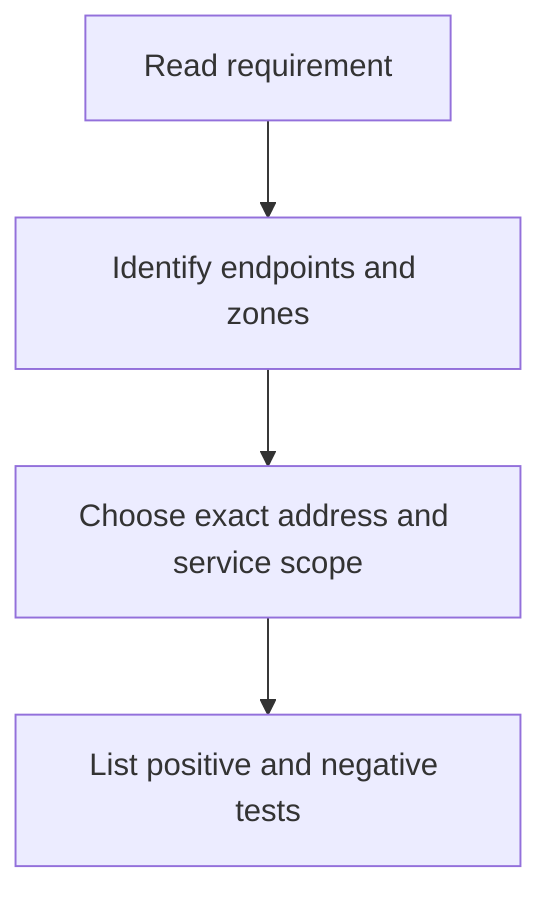
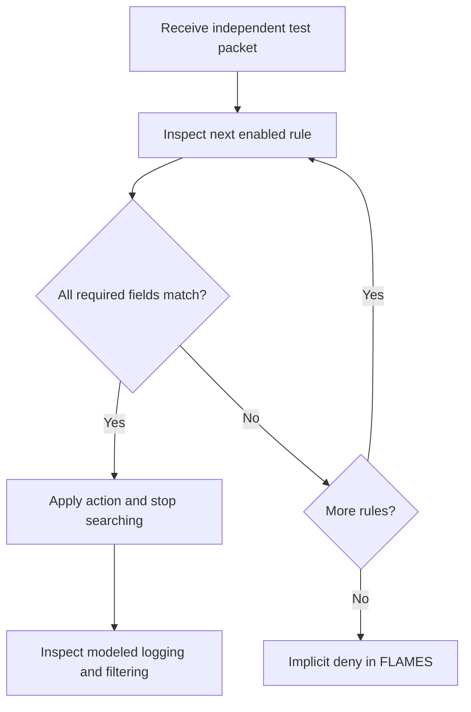
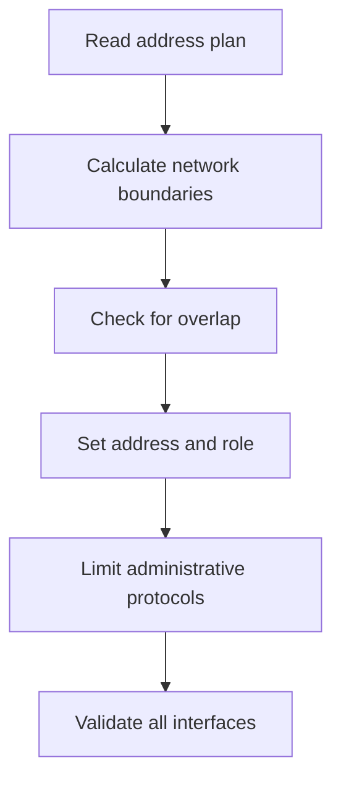
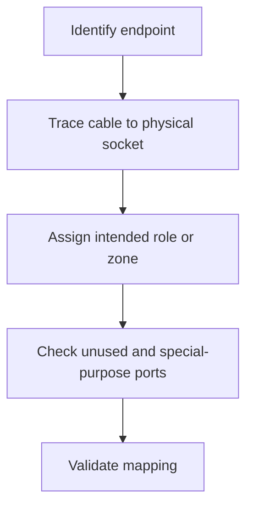
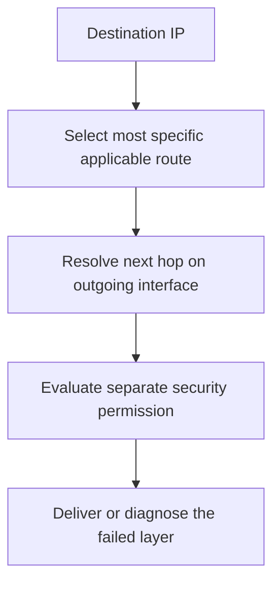
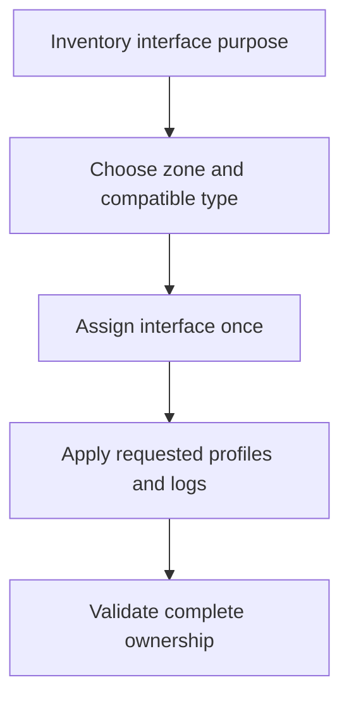
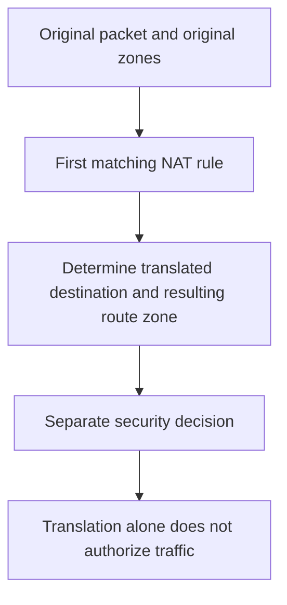
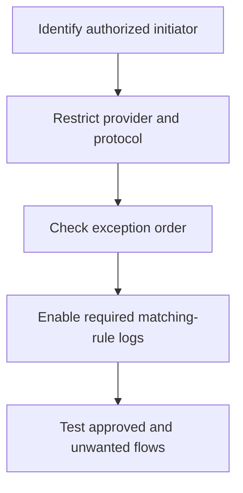
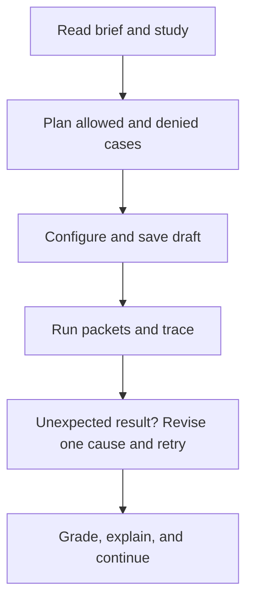

# FLAMES learning handbook

Learn the concepts, work an example, then practice and explain your result. This handbook covers all built-in FortiGate and Palo Alto tasks. When your administrator enables student access, open **Learning guide** in either course for the same material, searchable task paths, and direct practice links. The guide is hidden from students by default; administrators can enable it or preview it from the admin dashboard.

## Learning path

1. Start with packets, IPv4 prefixes, protocols, and trust boundaries.
2. Study hardware and cabling, then interfaces and management access.
3. Configure routing and least-privilege firewall policy.
4. Learn Palo Alto zones, application rules, and NAT as separate decisions.
5. Apply the operational labs, then complete each module assessment.

Allow approximately 8–12 hours for a first guided pass plus repeated practice; pace depends on prior networking experience. Reading alone does not mark tasks complete.

## Use this material

For each task, read its scenario for exact addresses and constraints. Review the linked chapter, draw a traffic matrix, configure the task, run positive and negative tests, inspect the first unexpected result, and submit grading. Examples deliberately use other networks and are not downloadable answer keys.

New Operations Practice modules add six FortiGate labs and three Palo Alto labs. Existing assessment prerequisites are unchanged. Instructor-authored modules may require additional instructor-provided material.

## Simulator boundaries

FLAMES tests independent modeled flows and finite configuration checks. It does not implement a complete stateful appliance, live application signatures, TLS inspection, real routing in the policy packet viewer, or production HA. Palo Alto special management/HA zones and static translation are teaching abstractions. Real device defaults, management architecture, application dependencies, and bidirectional NAT settings must be verified in vendor documentation.

## Chapters

- [Start here: packets, addresses, and trust](#foundations)
- [FortiGate policy and first-match evaluation](#policy)
- [Interfaces, CIDR, and administrative access](#addressing)
- [Hardware, cabling, and physical assignment](#ports)
- [Routing and the default path](#routing)
- [Palo Alto security policy and App-ID](#pan-security)
- [Palo Alto zones and interface ownership](#pan-zones)
- [Source NAT, destination NAT, and static mappings](#nat)
- [DNS, monitoring, quarantine, and restricted services](#operations)
- [How to practice, troubleshoot, and finish assessments](#workflow)

## Start here: packets, addresses, and trust

A firewall decision describes one attempted flow: where it enters, where it is going, the source and destination, and the requested service or application. Translate the written requirement into those fields before opening a rule editor. A zone groups networks by trust and purpose; its name does not grant permission.

### Understand the model

- LAN / Trust: internal users; WAN / Untrust: external networks; DMZ: exposed services with limited internal reach.
- A /32 IPv4 prefix describes one address. A /24 has 256 addresses; usable host conventions depend on the subnet type. A /28 spans 16 addresses, aligned on multiples of 16.
- TCP and UDP are different protocols. TCP/53 and UDP/53 are separate service matches. A port is not proof of an application.
- Ingress means incoming interface or zone; egress means outgoing interface or zone. A reply in an established real firewall session differs from a new reverse-initiated connection.

### Work through it

1. Write the source, destination, direction, protocol, and port/application for each requirement.
2. Draw each trust boundary and label endpoint addresses.
3. Make a two-column traffic matrix: flows to allow and flows to deny.
4. Check an intended host, a neighboring address outside the prefix, another service, and the reverse direction.

### Worked example

Example: 192.0.2.32/28 covers 192.0.2.32–192.0.2.47. A packet from 192.0.2.50 is outside that object. If only a single partner host is trusted, use its /32 rather than enlarging the subnet. Documentation example addresses are not deployment settings.

| Input | Expected observation | Why |
| --- | --- | --- |
| 192.0.2.35 against 192.0.2.32/28 | Inside the range | The /28 spans .32 through .47. |
| 192.0.2.50 against the same object | Outside the range | It belongs to a neighboring range. |
| TCP/53 against a UDP/53 service | No match | Transport protocol is part of a service match. |

### Decision flow

Text equivalent: Read requirement → Identify endpoints and zones → Choose exact address and service scope → List positive and negative tests.

### Common mistakes

- Treating every host in the same zone as equally trusted.
- Assuming a host address with /24 matches only that host.
- Assuming a reverse-direction test represents reply traffic. FLAMES tests independent flows, not a complete stateful session table.

### Check your understanding

Explain why an HTTPS allow to one host must not authorize SSH to that host or HTTPS to a neighboring host.

**Explanation:** A rule permitting one destination and one service matches only that combination. A different destination or service fails the match. Include both dimensions in negative tests; do not infer application identity solely from a port.

## FortiGate policy and first-match evaluation

FLAMES evaluates enabled rules from the top. A rule must match the direction, source object, destination object, and service. The first matching action wins. An unmatched packet is denied. Start with narrow permissions, then add any exceptions above overlapping broad rules.

### Understand the model

- Multiple selected source objects are alternatives; source and destination conditions must both match.
- An enabled deny above a broad allow can implement a quarantine exception. A disabled rule has no effect.
- Logging is checked on the rule that actually matches, including an explicit deny when denial logging is required.
- Web filtering in FLAMES uses supplied test-domain metadata. It does not implement browser DNS, TLS decryption, or live URL inspection.

### Work through it

1. Create or inspect the address and service objects before referencing them.
2. Click Create New and enter a descriptive rule name.
3. Choose the incoming and outgoing interfaces, exact address objects, and required services.
4. Set the action and logging requirement. Add the rule.
5. Select and move rules when a specific exception needs to precede a broader rule.
6. Run test packets, inspect Trace packet flow and Network view, then Check my work.

### Worked example

Worked example on a separate practice network: deny the quarantined host 192.0.2.44/32 before allowing Office 192.0.2.0/24 to WAN on HTTPS. Test .44/443 (deny), .45/443 (allow), and .45/22 (deny). Moving the deny below the broad allow changes the first result.

| Input | Expected observation | Why |
| --- | --- | --- |
| Quarantined .44 → WAN TCP/443 | Deny | Specific deny precedes the office allow. |
| Office .45 → WAN TCP/443 | Allow | Matches the approved office HTTPS path. |
| Office .45 → WAN TCP/22 | Deny | No SSH permission is present. |

### Decision flow

Text equivalent: Receive independent test packet → Find next enabled rule → Do direction, addresses, and service all match? → No: inspect next rule; none left: deny → Yes: apply action and matching-rule logging → Apply modeled filter if configured; report result.

### Common mistakes

- Putting a quarantine deny below an overlapping allow.
- Selecting all services because the destination is already narrow.
- Logging a rule that never matches rather than the effective rule.
- Treating the finite packet test set as proof of a production security policy.

### Check your understanding

Trace one allowed packet and one denied packet by hand. Identify the exact first matching rule or implicit deny.

**Explanation:** Walk from the first enabled rule until every matching field is satisfied. Stop at that rule and inspect its action and logging. If no rule matches, FLAMES denies the flow. A later rule cannot repair an earlier overly broad permission.

## Interfaces, CIDR, and administrative access

An interface connects the firewall to a network. Its address and mask define a connected subnet. A role is an organizational label; management protocols expose the firewall itself and need separate limits. Avoid overlapping routed interface networks.

### Understand the model

- 192.0.2.65/26 belongs to the 192.0.2.64–127 range.
- HTTPS/SSH administrative access targets the firewall; an ordinary security rule forwards a connection to another host.
- Do not enable HTTP or Telnet for convenience when the requirement permits only encrypted administration.
- Role, link mode, zone membership, and IP addressing are separate settings.

### Work through it

1. List the required network and gateway address for every interface.
2. Determine each prefix boundary and verify that routed networks do not overlap.
3. Set the interface address, netmask, and role as requested.
4. Enable only the listed administrative protocols.
5. Check every interface, including ones that should have no administrative access.

### Worked example

Example branch plan: internal gateway 192.0.2.1/26 and server gateway 192.0.2.65/26 use distinct subnets. Assigning 192.0.2.2/24 to a second routed interface would overlap the first. HTTPS on the internal interface does not automatically grant SSH to a server behind it.

| Input | Expected observation | Why |
| --- | --- | --- |
| 192.0.2.1/26 and 192.0.2.65/26 | Non-overlapping | They belong to .0–63 and .64–127. |
| 192.0.2.2/24 with 192.0.2.1/26 | Overlapping | The /24 contains the smaller network. |
| Internal HTTPS administrative access | Firewall administration only | It does not automatically permit SSH to a downstream server. |

### Decision flow

Text equivalent: Read address plan → Calculate network boundaries → Check for overlap → Set address and role → Limit administrative protocols → Validate all interfaces.

### Common mistakes

- Entering a network address where a host interface address is needed.
- Choosing a role and assuming it changes access permissions.
- Leaving management protocols enabled on an external interface.

### Check your understanding

Given two proposed interface prefixes, show whether they overlap and name which management protocols the requirement actually needs.

**Explanation:** Compute each network range using the prefix length and compare the intervals. Any common address means overlap. Enable only the administration protocols explicitly required for the interface; an interface role does not grant access.

## Hardware, cabling, and physical assignment

Trace the connected endpoint before assigning a port. The same physical position can serve different purposes in different deployments. Hardware Explore mode explains components; Cable mode offers keyboard-selectable cables and sockets. A connected cable alone does not create an IP configuration or permission.

### Understand the model

- WAN uplink: provider-facing path; LAN: internal users; DMZ: exposed server segment.
- Dual WAN requires routing and failover design beyond assigning two links.
- HA synchronization and management links have separate purposes from ordinary production traffic.
- Unused ports should remain unused when the exercise requires spare capacity.

### Work through it

1. Read the endpoint inventory and inspect the hardware reference.
2. Map each cable or listed connection to its endpoint and intended zone.
3. Assign ports from that inventory, not from memorized chassis position.
4. Check spare ports and any HA or management links.
5. Submit the assignment and inspect feedback for swapped endpoints.

### Worked example

Example: if port 4 is cabled to a public server and port 1 to an office switch, their assignments follow those endpoints. Reversing the labels because port 1 is usually WAN creates the wrong trust boundary.

| Input | Expected observation | Why |
| --- | --- | --- |
| Port 4 connected to an exposed service | Evaluate as the server-facing connection | Use the actual connected endpoint. |
| Port 1 connected to the office switch | Evaluate as the internal connection | A port number alone does not determine trust. |
| Second provider cable connected | Physical redundancy only | Routes and failover behavior still need configuration. |

### Decision flow

Text equivalent: Identify endpoint → Trace cable to physical socket → Assign intended role or zone → Check unused and special-purpose ports → Validate mapping.

### Common mistakes

- Assuming a familiar port number always means WAN.
- Placing a public-facing server on the employee segment.
- Claiming automatic failover after labeling a second WAN connection.

### Check your understanding

Explain what remains to configure after the correct cable is connected: addressing, routes, security policy, and any required NAT.

**Explanation:** A cable establishes the physical connection. A usable service path also needs compatible interface configuration, reachability, security permission, and any translation required by the design. Redundant provider links need an explicit failover mechanism.

## Routing and the default path

A policy permission cannot make an unreachable destination reachable. A route selects a next hop and outgoing interface. FLAMES has a separate route exercise; the policy simulator receives its incoming and outgoing interfaces from the test packet and does not perform full route lookup.

### Understand the model

- 0.0.0.0/0 is the default IPv4 route. More specific destination prefixes normally take precedence.
- A gateway must be reachable using the selected outgoing network.
- Administrative distance distinguishes competing routes; it is not a substitute for a more specific prefix.

### Work through it

1. Identify the ISP-facing interface and its connected subnet.
2. Choose the required destination prefix, next-hop address, and outgoing interface.
3. Add the default route when external destinations have no more specific route.
4. Check the gateway, prefix, and administrative distance against the exercise.
5. Troubleshoot routing separately from policy, addressing, and translation.

### Worked example

Example: a WAN interface at 198.51.100.2/30 can use a reachable next hop at 198.51.100.1. A default route points to that next hop; it does not authorize internal clients to use every service.

| Input | Expected observation | Why |
| --- | --- | --- |
| WAN 198.51.100.2/30, next hop .1 | Gateway is in the same connected range | The /30 covers .0–3. |
| Default destination 0.0.0.0/0 | Fallback route candidate | A more specific applicable route takes precedence. |
| Policy permits HTTPS but no usable route exists | Connectivity still fails | Security permission does not create reachability. |

### Decision flow

Text equivalent: Destination IP → Select most specific applicable route → Resolve next hop on outgoing interface → Evaluate separate security permission → Deliver or diagnose the failed layer.

### Common mistakes

- Using an unreachable gateway on another subnet.
- Adding an allow rule to repair a missing route.
- Assuming the policy packet animation validates the routing table.

### Check your understanding

Name three independent causes of failed internet access even when an allow rule looks correct.

**Explanation:** Possible causes include a missing route, an unreachable next hop, incorrect interface addressing, missing required NAT, and a blocked return path. An allow rule only addresses one layer of that diagnosis.

## Palo Alto security policy and App-ID

The FLAMES Palo Alto security model matches source zone, destination zone, and a supplied application label. Rules are ordered and unmatched traffic is denied in this simulator. App-ID exercises teach application scope; they do not run a live signature engine.

### Understand the model

- Trust, Untrust, DMZ, and Management name distinct security contexts.
- web-browsing, ssl, dns, ssh, and smtp are separate application choices.
- Real PAN-OS default intra-zone/inter-zone behavior, application dependencies, service constraints, and session handling require vendor-specific configuration. The simulator uses a simplified default deny.
- Authorizing Management to initiate SSH does not authorize Trust to initiate a new connection to Management.

### Work through it

1. Convert each requirement into a source-zone, destination-zone, application, and action row.
2. Add a rule with only the requested applications.
3. Place explicit risky-application blocks before overlapping allows when required.
4. Add the explicit catch-all deny when the task asks for it.
5. Run application packets and inspect the first matching rule.
6. Test reverse initiation and non-approved applications before submitting.

### Worked example

Worked example: Management → DMZ, application ssh, allow; then any → any, application any, deny. A Management→DMZ ssh packet matches the first rule. A DMZ→Management ssh packet reaches the final deny. This example deliberately grants no web or mail application.

| Input | Expected observation | Why |
| --- | --- | --- |
| Management → DMZ application ssh | Allow in the worked example | Matches the narrow administration rule. |
| DMZ → Management application ssh | Deny in the worked example | Reverse initiation has no allow rule. |
| Management → DMZ application smtp | Deny in the worked example | The permission is limited to ssh. |

### Decision flow

Text equivalent: Read supplied source zone, destination zone, and application → Inspect security rules top to bottom → First complete match? → Yes: allow or deny by that rule → No match: simulator denies.

### Common mistakes

- Allowing any application to simplify an approved list.
- Putting an explicit application block after an overlapping allow.
- Assuming that a zone name implements asymmetric trust automatically.

### Check your understanding

Explain why identifying an application and authorizing that application are separate jobs.

**Explanation:** Application identification tells the policy which application a flow represents. Authorization still depends on the matching rule and zone direction. FLAMES receives an application label; it does not identify applications from live packet payloads.

## Palo Alto zones and interface ownership

Zone configuration groups interfaces into intended trust boundaries. FLAMES includes Layer 3, Layer 2, tap, HA, and management teaching choices. Treat the special HA and management zone choices as simulator abstractions; real dedicated management and HA configuration must follow the device documentation.

### Understand the model

- Layer 3 interfaces route using IP addresses. Layer 2 and virtual-wire designs have different forwarding models.
- An interface must not be assigned to multiple zones in the same exercise.
- Zone protection profiles and log forwarding settings are distinct from ordinary security-policy permission.

### Work through it

1. List each interface and its intended network or special purpose.
2. Create the required zone names and types.
3. Assign each interface to its intended zone once.
4. Apply the protection and log-forwarding settings stated in the task.
5. Inspect ownership across the complete zone list before submitting.

### Worked example

Example inventory: provider link → Untrust, office switch → Trust, exposed services → DMZ. Keep synchronization and administrative paths separate; do not place them in a production zone merely to make a data policy match.

| Input | Expected observation | Why |
| --- | --- | --- |
| Provider interface | Untrust in the example inventory | The endpoint is external connectivity. |
| One interface listed under two zones | Invalid ownership in the exercise | Each interface must have one intended zone owner. |
| A correctly named Management zone without required logging | Incomplete task configuration | The name does not apply log forwarding. |

### Decision flow

Text equivalent: Inventory interface purpose → Choose zone and compatible type → Assign interface once → Apply requested profiles and logs → Validate complete ownership.

### Common mistakes

- Assigning one interface to two zones.
- Treating a zone-protection profile as a service allow rule.
- Copying simulator management/HA abstractions directly into real appliance configuration.

### Check your understanding

Describe the difference between zone membership, zone protection, and a security rule.

**Explanation:** Membership associates interfaces with a trust context. Protection profiles provide separate zone-level controls. Security rules authorize specified flows between contexts. Correctly configuring one does not automatically configure the other two.

## Source NAT, destination NAT, and static mappings

NAT changes addresses; security policy decides permission. Inbound destination translation may send a public address toward a private DMZ address. The FLAMES NAT exercise checks mappings separately from the security exercise. A successful translation in Network view does not imply an allowed connection.

### Understand the model

- Source NAT changes a source address. The interface choice models outbound interface-address sharing.
- Destination NAT redirects an original public destination to an internal service.
- NAT policy uses original-packet zone matching. Real PAN-OS security policy uses original addresses and post-NAT destination zones.
- Static mappings are simplified in FLAMES. On real PAN-OS, reverse behavior depends on the configured bidirectional settings and rule applicability; static NAT alone is not a universal automatic inbound permission.

### Work through it

1. Write an original-packet tuple and the intended translated address.
2. Choose source, destination, or static translation for the requirement.
3. For the inbound FLAMES DNAT example, select the required original Untrust → Untrust zone pair.
4. Enter exact original and translated addresses; do not use an unrelated rule to satisfy half the mapping.
5. Order specific mappings ahead of broader overlapping rules.
6. Validate the NAT task, then reason about the separate security permission needed for the translated path.

### Worked example

Worked example: public 203.0.113.80 translates to a server at 192.0.2.80 in DMZ. NAT matching considers the original path. The real security rule refers to the original destination 203.0.113.80 and the destination zone after translation, DMZ. FLAMES security rules model zones and application only, so they cannot reproduce that full address match.

| Input | Expected observation | Why |
| --- | --- | --- |
| Original public destination 203.0.113.80 | Matched by the original-packet NAT rule | The private translated address is not the original destination. |
| Translation to 192.0.2.80 in DMZ | Separate security decision still needed | Address translation grants no permission. |
| Real security rule for this DNAT flow | Original public address and post-NAT DMZ zone | Original address matching and zone selection are different dimensions. |

### Decision flow

Text equivalent: Original packet and original zones → First matching NAT rule → Determine translated destination and resulting route zone → Separate security decision → Translation alone does not authorize traffic.

### Common mistakes

- Treating NAT as an allow rule.
- Selecting a post-NAT DMZ zone in an original-packet NAT rule where Untrust is required.
- Assuming every static mapping enables reverse sessions without further configuration.

### Check your understanding

Explain what each rule matches before and after destination translation, then explain which parts FLAMES simplifies.

**Explanation:** The NAT match describes the original packet and zones. For real destination NAT, security matching keeps the original addresses but uses the resulting destination zone. FLAMES models the NAT mapping separately and its security exercise checks zones and application, not the full real-device address match.

## DNS, monitoring, quarantine, and restricted services

Operational access should have a named consumer, a named provider, and a narrow service. Logging supports diagnosis but does not change permission. The added practice tasks combine protocol selection, address boundaries, rule order, and directionality.

### Understand the model

- DNS can use both UDP and TCP; an approved resolver rule should follow the task’s stated transports.
- NTP normally uses UDP/123. The exercise checks protocol and a particular destination server.
- Syslog in this exercise is UDP/514; real logging deployments can use other transports and security controls.
- A quarantined host deny needs to precede a broader subnet allow if both match.

### Work through it

1. Identify which endpoint initiates each operational flow.
2. Restrict the consumer subnet or host and the provider host.
3. Choose the exact protocol/service and required logging.
4. Add a logged quarantine exception ahead of broad access if required.
5. Test an adjacent source, another provider, the wrong protocol, and reverse initiation.

### Worked example

Worked example: a collector at 192.0.2.60 accepts UDP/514 from one server at 192.0.2.70. That telemetry permission does not authorize collector→office SSH. A separate administrator HTTPS path needs its own source and destination scope.

| Input | Expected observation | Why |
| --- | --- | --- |
| Named server → collector UDP/514 | Eligible for narrow telemetry permission | Consumer, provider, transport, and service match. |
| Collector → office SSH | Separate authorization needed | Sending telemetry does not grant reverse access. |
| Quarantined host matches a broad office allow first | Unexpected allow | Move the narrow deny before the overlapping allow. |

### Decision flow

Text equivalent: Identify authorized initiator → Restrict provider and protocol → Check exception order → Enable required matching-rule logs → Test approved and unwanted flows.

### Common mistakes

- Allowing every resolver or every time server.
- Granting administration rights because a host receives telemetry.
- Relying on implicit deny when the task requires a logged explicit denial.

### Check your understanding

For each operational rule, name one packet that should pass and three similar packets that should fail.

**Explanation:** For a restricted operational service, allow the named consumer to the named provider using the exact protocol and service. Reject another source, another provider, another service, and reverse initiation unless separately required. Check matching-rule logging where specified.

## How to practice, troubleshoot, and finish assessments

Use the guide for concepts, the scenario for exact requirements, packet tools for your current configuration, and grading for completion. Read examples before attempting a task, then explain a decision without the guide. Existing drafts save automatically; they are not proof of successful completion.

### Understand the model

- Run test packets and Network view are exploratory; Check my work performs the graded validation.
- A knowledge check is an alternate concept-based completion route where offered. Bank and AI labels describe the question source.
- Assessments unlock after the non-final lessons in their module. The separate Operations Practice module does not change existing assessment prerequisites.
- Course progress belongs to your signed-in account or connected Academy deployment. Guest drafts remain local and are not a substitute for account progress.

### Work through it

1. Read the brief and prepare a traffic matrix or configuration inventory.
2. Study the relevant chapter and its worked example.
3. Build your own configuration from the task’s addresses and requirements.
4. Run positive and negative tests, then trace the first unexpected result.
5. Change one cause at a time: scope, direction, order, protocol, route, or translation.
6. Submit grading; inspect every failed requirement and repeat.
7. Record the final reasoning and test evidence before moving to an assessment.

### Worked example

Troubleshooting example: HTTPS fails. First verify the packet’s supplied direction, then the destination object, then TCP/443, then earlier rules, then logging requirements. A NAT-only result cannot prove authorization. For a real deployment, separately inspect route reachability, session state, and return path.

| Input | Expected observation | Why |
| --- | --- | --- |
| Run test packets shows a result | Exploratory evidence | It is not graded completion. |
| Check my work reports a failed logging requirement | Inspect the effective matching rule | An unrelated logged rule cannot satisfy the flow. |
| A previously untested negative case passes | Revisit scope and order | The finite successful tests did not establish the intended boundary. |

### Decision flow

Text equivalent: Read brief and study → Plan allowed and denied cases → Configure and save draft → Run packets and trace → Unexpected result? Revise one cause and retry → Grade, explain, and continue.

### Common mistakes

- Submitting without testing a denied case.
- Resetting a useful draft before understanding the failed check.
- Copying a worked example’s addresses instead of reading the task.
- Treating a passed finite exercise as production validation.

### Check your understanding

Can you reconstruct the design, explain every permission, and predict a new negative test without copying a saved rulebase?

**Explanation:** A strong explanation names the permitted initiator, destination, service, relevant rule order, and test evidence. Predict another packet outside the intended scope and explain which rule or implicit denial will block it. If you cannot predict that outcome, return to the traffic matrix.

## Task-by-task study plans

Use these plans with the exact task scenario in the application. Each checklist includes deliberate negative tests, not just successful access.

### FortiGate Firewall Administration

#### Firewall Policy

##### Web Server Access

Task: `web-server-access-01` · Foundation · 10 minutes

Publish one DMZ server over HTTPS and nothing else.

**Study:** [FortiGate policy and first-match evaluation](#policy); also review [packet foundations](#foundations) and the [practice workflow](#workflow).

**Plan:** Separate public HTTPS exposure from other WAN services.

**Practice:**

1. Open the task and read every requirement before editing.
2. Write a traffic matrix or interface/port inventory using its exact values.
3. Follow the chapter procedure to build your own configuration.
4. Test SSH, plain HTTP, and another DMZ destination, not only the intended web server.
5. Run available packet tools, inspect feedback, and submit Check my work.
6. Explain one passing case and one deliberately blocked case without consulting the guide.

Open in FLAMES: `/fortigate/policy/firewall-policy?scenario=web-server-access-01`

##### Database Server Lockdown

Task: `db-lockdown-01` · Foundation · 12 minutes

Restrict a database to its SQL port from one subnet.

**Study:** [FortiGate policy and first-match evaluation](#policy); also review [packet foundations](#foundations) and the [practice workflow](#workflow).

**Plan:** Express the permitted client subnet and database service independently.

**Practice:**

1. Open the task and read every requirement before editing.
2. Write a traffic matrix or interface/port inventory using its exact values.
3. Follow the chapter procedure to build your own configuration.
4. Try a client outside the allowed subnet and a non-database service.
5. Run available packet tools, inspect feedback, and submit Check my work.
6. Explain one passing case and one deliberately blocked case without consulting the guide.

Open in FLAMES: `/fortigate/policy/firewall-policy?scenario=db-lockdown-01`

##### DMZ Multi-Service

Task: `dmz-multi-service-01` · Foundation · 12 minutes

Allow several inbound services to a single DMZ host.

**Study:** [FortiGate policy and first-match evaluation](#policy); also review [packet foundations](#foundations) and the [practice workflow](#workflow).

**Plan:** Select each approved inbound service without widening all services.

**Practice:**

1. Open the task and read every requirement before editing.
2. Write a traffic matrix or interface/port inventory using its exact values.
3. Follow the chapter procedure to build your own configuration.
4. Test an unlisted service and a newly initiated DMZ-to-LAN connection.
5. Run available packet tools, inspect feedback, and submit Check my work.
6. Explain one passing case and one deliberately blocked case without consulting the guide.

Open in FLAMES: `/fortigate/policy/firewall-policy?scenario=dmz-multi-service-01`

##### Inter-Zone Trust

Task: `inter-zone-trust-01` · Intermediate · 15 minutes

Let LAN reach the DMZ without letting the DMZ reach back.

**Study:** [FortiGate policy and first-match evaluation](#policy); also review [packet foundations](#foundations) and the [practice workflow](#workflow).

**Plan:** Write the allowed initiation direction separately from the reverse direction.

**Practice:**

1. Open the task and read every requirement before editing.
2. Write a traffic matrix or interface/port inventory using its exact values.
3. Follow the chapter procedure to build your own configuration.
4. Do not add a reverse allow merely to model reply packets.
5. Run available packet tools, inspect feedback, and submit Check my work.
6. Explain one passing case and one deliberately blocked case without consulting the guide.

Open in FLAMES: `/fortigate/policy/firewall-policy?scenario=inter-zone-trust-01`

##### Full Network Policy

Task: `full-network-policy-01` · Intermediate · 20 minutes

Compose a complete small-network policy set.

**Study:** [FortiGate policy and first-match evaluation](#policy); also review [packet foundations](#foundations) and the [practice workflow](#workflow).

**Plan:** Prepare one matrix covering every zone pair before adding rules.

**Practice:**

1. Open the task and read every requirement before editing.
2. Write a traffic matrix or interface/port inventory using its exact values.
3. Follow the chapter procedure to build your own configuration.
4. Check broad rules for unintended matches and test all denied directions.
5. Run available packet tools, inspect feedback, and submit Check my work.
6. Explain one passing case and one deliberately blocked case without consulting the guide.

Open in FLAMES: `/fortigate/policy/firewall-policy?scenario=full-network-policy-01`

##### Block One Host

Task: `multi-system-block-01` · Intermediate · 12 minutes

Carve one system out of a subnet-wide allow rule.

**Study:** [FortiGate policy and first-match evaluation](#policy); also review [packet foundations](#foundations) and the [practice workflow](#workflow).

**Plan:** Identify the narrow blocked host and the overlapping allowed subnet.

**Practice:**

1. Open the task and read every requirement before editing.
2. Write a traffic matrix or interface/port inventory using its exact values.
3. Follow the chapter procedure to build your own configuration.
4. Trace the blocked host through the complete rule order.
5. Run available packet tools, inspect feedback, and submit Check my work.
6. Explain one passing case and one deliberately blocked case without consulting the guide.

Open in FLAMES: `/fortigate/policy/firewall-policy?scenario=multi-system-block-01`

##### Web Filtering

Task: `web-filter-instagram-01` · Intermediate · 15 minutes

Block a site that IP and port rules cannot reliably stop.

**Study:** [FortiGate policy and first-match evaluation](#policy); also review [packet foundations](#foundations) and the [practice workflow](#workflow).

**Plan:** Distinguish transport permission from a supplied-domain filter decision.

**Practice:**

1. Open the task and read every requirement before editing.
2. Write a traffic matrix or interface/port inventory using its exact values.
3. Follow the chapter procedure to build your own configuration.
4. Test both an allowed domain and a blocked domain using the permitted transport.
5. Run available packet tools, inspect feedback, and submit Check my work.
6. Explain one passing case and one deliberately blocked case without consulting the guide.

Open in FLAMES: `/fortigate/policy/firewall-policy?scenario=web-filter-instagram-01`

##### Server Segmentation

Task: `server-segmentation-01` · Advanced · 15 minutes

Enforce one-way access between workstations and servers.

**Study:** [FortiGate policy and first-match evaluation](#policy); also review [packet foundations](#foundations) and the [practice workflow](#workflow).

**Plan:** Calculate the two /25 ranges before selecting source and destination objects.

**Practice:**

1. Open the task and read every requirement before editing.
2. Write a traffic matrix or interface/port inventory using its exact values.
3. Follow the chapter procedure to build your own configuration.
4. Test server-initiated access back to workstations and the wrong service.
5. Run available packet tools, inspect feedback, and submit Check my work.
6. Explain one passing case and one deliberately blocked case without consulting the guide.

Open in FLAMES: `/fortigate/policy/firewall-policy?scenario=server-segmentation-01`

##### Guest Network Isolation

Task: `guest-isolation-01` · Advanced · 15 minutes

Isolate two subnets that share a zone.

**Study:** [FortiGate policy and first-match evaluation](#policy); also review [packet foundations](#foundations) and the [practice workflow](#workflow).

**Plan:** Notice that the guest range overlaps the larger corporate object in the exercise.

**Practice:**

1. Open the task and read every requirement before editing.
2. Write a traffic matrix or interface/port inventory using its exact values.
3. Follow the chapter procedure to build your own configuration.
4. Protect the guest exception before broader matches and test both local directions.
5. Run available packet tools, inspect feedback, and submit Check my work.
6. Explain one passing case and one deliberately blocked case without consulting the guide.

Open in FLAMES: `/fortigate/policy/firewall-policy?scenario=guest-isolation-01`

##### Multi-Server DMZ Access

Task: `multi-dmz-access-01` · Advanced · 18 minutes

Different exposure for each server in the same DMZ.

**Study:** [FortiGate policy and first-match evaluation](#policy); also review [packet foundations](#foundations) and the [practice workflow](#workflow).

**Plan:** Create a service exposure matrix for web, mail, and administration.

**Practice:**

1. Open the task and read every requirement before editing.
2. Write a traffic matrix or interface/port inventory using its exact values.
3. Follow the chapter procedure to build your own configuration.
4. Test public SSH to the management server and DMZ-to-LAN initiation.
5. Run available packet tools, inspect feedback, and submit Check my work.
6. Explain one passing case and one deliberately blocked case without consulting the guide.

Open in FLAMES: `/fortigate/policy/firewall-policy?scenario=multi-dmz-access-01`

##### Firewall Policy Assessment

Task: `firewall-final-01` · Advanced · 30 minutes · Module assessment

Everything in this module, in one network.

**Study:** [How to practice, troubleshoot, and finish assessments](#workflow); also review [packet foundations](#foundations) and the [practice workflow](#workflow).

**Plan:** Combine directions, object boundaries, ordering, filtering, and required logs.

**Practice:**

1. Open the task and read every requirement before editing.
2. Write a traffic matrix or interface/port inventory using its exact values.
3. Follow the chapter procedure to build your own configuration.
4. Review every failed diagnostic rather than assuming one successful packet proves the design.
5. Run available packet tools, inspect feedback, and submit Check my work.
6. Explain one passing case and one deliberately blocked case without consulting the guide.

Open in FLAMES: `/fortigate/policy/firewall-policy?scenario=firewall-final-01`

#### Interfaces

##### Interface IP Assignment

Task: `interface-ip-01` · Foundation · 10 minutes

Give each interface the right address and mask.

**Study:** [Interfaces, CIDR, and administrative access](#addressing); also review [packet foundations](#foundations) and the [practice workflow](#workflow).

**Plan:** Calculate each connected subnet from the supplied address and mask.

**Practice:**

1. Open the task and read every requirement before editing.
2. Write a traffic matrix or interface/port inventory using its exact values.
3. Follow the chapter procedure to build your own configuration.
4. Check every interface, not only the first one.
5. Run available packet tools, inspect feedback, and submit Check my work.
6. Explain one passing case and one deliberately blocked case without consulting the guide.

Open in FLAMES: `/fortigate/network/interfaces?track=interface&scenario=interface-ip-01`

##### Administrative Access

Task: `interface-access-01` · Foundation · 10 minutes

Decide which management protocols each interface allows.

**Study:** [Interfaces, CIDR, and administrative access](#addressing); also review [packet foundations](#foundations) and the [practice workflow](#workflow).

**Plan:** Inventory management protocols for each interface separately.

**Practice:**

1. Open the task and read every requirement before editing.
2. Write a traffic matrix or interface/port inventory using its exact values.
3. Follow the chapter procedure to build your own configuration.
4. Remove unrequested administration instead of only enabling missing protocols.
5. Run available packet tools, inspect feedback, and submit Check my work.
6. Explain one passing case and one deliberately blocked case without consulting the guide.

Open in FLAMES: `/fortigate/network/interfaces?track=interface&scenario=interface-access-01`

##### Custom Addressing Scheme

Task: `interface-custom-01` · Intermediate · 15 minutes

Work from a non-default branch address plan.

**Study:** [Interfaces, CIDR, and administrative access](#addressing); also review [packet foundations](#foundations) and the [practice workflow](#workflow).

**Plan:** Use the custom branch plan rather than the default example ranges.

**Practice:**

1. Open the task and read every requirement before editing.
2. Write a traffic matrix or interface/port inventory using its exact values.
3. Follow the chapter procedure to build your own configuration.
4. Calculate smaller subnet boundaries and check for overlap.
5. Run available packet tools, inspect feedback, and submit Check my work.
6. Explain one passing case and one deliberately blocked case without consulting the guide.

Open in FLAMES: `/fortigate/network/interfaces?track=interface&scenario=interface-custom-01`

##### Interfaces Assessment

Task: `interface-full-01` · Advanced · 25 minutes · Module assessment

Configure every interface from scratch.

**Study:** [Interfaces, CIDR, and administrative access](#addressing); also review [packet foundations](#foundations) and the [practice workflow](#workflow).

**Plan:** Build a complete address, role, and management-access inventory.

**Practice:**

1. Open the task and read every requirement before editing.
2. Write a traffic matrix or interface/port inventory using its exact values.
3. Follow the chapter procedure to build your own configuration.
4. Inspect the external interface for unnecessary management exposure.
5. Run available packet tools, inspect feedback, and submit Check my work.
6. Explain one passing case and one deliberately blocked case without consulting the guide.

Open in FLAMES: `/fortigate/network/interfaces?track=interface&scenario=interface-full-01`

#### Port Assignment

##### Basic Port Assignment

Task: `port-assignment-01` · Foundation · 8 minutes

WAN, LAN, and DMZ on a small office firewall.

**Study:** [Hardware, cabling, and physical assignment](#ports); also review [packet foundations](#foundations) and the [practice workflow](#workflow).

**Plan:** Map the small-office endpoint inventory to WAN, LAN, and DMZ.

**Practice:**

1. Open the task and read every requirement before editing.
2. Write a traffic matrix or interface/port inventory using its exact values.
3. Follow the chapter procedure to build your own configuration.
4. Trace each endpoint before relying on a remembered port label.
5. Run available packet tools, inspect feedback, and submit Check my work.
6. Explain one passing case and one deliberately blocked case without consulting the guide.

Open in FLAMES: `/fortigate/network/interfaces?track=port&scenario=port-assignment-01`

##### Multi-Server DMZ

Task: `port-multi-dmz-01` · Foundation · 10 minutes

Give two public servers their own DMZ ports.

**Study:** [Hardware, cabling, and physical assignment](#ports); also review [packet foundations](#foundations) and the [practice workflow](#workflow).

**Plan:** Distinguish the two server connections from user and provider links.

**Practice:**

1. Open the task and read every requirement before editing.
2. Write a traffic matrix or interface/port inventory using its exact values.
3. Follow the chapter procedure to build your own configuration.
4. Check both server assignments and the remaining ports.
5. Run available packet tools, inspect feedback, and submit Check my work.
6. Explain one passing case and one deliberately blocked case without consulting the guide.

Open in FLAMES: `/fortigate/network/interfaces?track=port&scenario=port-multi-dmz-01`

##### Redundant WAN Uplinks

Task: `port-redundant-wan-01` · Intermediate · 10 minutes

Connect two ISPs for failover.

**Study:** [Hardware, cabling, and physical assignment](#ports); also review [packet foundations](#foundations) and the [practice workflow](#workflow).

**Plan:** Identify both independent provider uplinks.

**Practice:**

1. Open the task and read every requirement before editing.
2. Write a traffic matrix or interface/port inventory using its exact values.
3. Follow the chapter procedure to build your own configuration.
4. Explain why the assignment itself does not implement routing failover.
5. Run available packet tools, inspect feedback, and submit Check my work.
6. Explain one passing case and one deliberately blocked case without consulting the guide.

Open in FLAMES: `/fortigate/network/interfaces?track=port&scenario=port-redundant-wan-01`

##### Larger Office Network

Task: `port-large-office-01` · Intermediate · 12 minutes

Scale the LAN and leave spare ports unused.

**Study:** [Hardware, cabling, and physical assignment](#ports); also review [packet foundations](#foundations) and the [practice workflow](#workflow).

**Plan:** Inventory office expansion and spare ports before assigning the chassis.

**Practice:**

1. Open the task and read every requirement before editing.
2. Write a traffic matrix or interface/port inventory using its exact values.
3. Follow the chapter procedure to build your own configuration.
4. Verify that ports intended to remain unused were not added to LAN.
5. Run available packet tools, inspect feedback, and submit Check my work.
6. Explain one passing case and one deliberately blocked case without consulting the guide.

Open in FLAMES: `/fortigate/network/interfaces?track=port&scenario=port-large-office-01`

##### Don't Assume by Position

Task: `port-position-trap-01` · Advanced · 12 minutes

Zone by what is connected, not where the port sits.

**Study:** [Hardware, cabling, and physical assignment](#ports); also review [packet foundations](#foundations) and the [practice workflow](#workflow).

**Plan:** Ignore expected physical order and read the connected-system descriptions.

**Practice:**

1. Open the task and read every requirement before editing.
2. Write a traffic matrix or interface/port inventory using its exact values.
3. Follow the chapter procedure to build your own configuration.
4. Check the endpoint behind every unusual port position.
5. Run available packet tools, inspect feedback, and submit Check my work.
6. Explain one passing case and one deliberately blocked case without consulting the guide.

Open in FLAMES: `/fortigate/network/interfaces?track=port&scenario=port-position-trap-01`

##### Port Assignment Assessment

Task: `port-final-01` · Advanced · 20 minutes · Module assessment

Every port concept on one chassis.

**Study:** [Hardware, cabling, and physical assignment](#ports); also review [packet foundations](#foundations) and the [practice workflow](#workflow).

**Plan:** Reconstruct the entire chassis inventory without positional assumptions.

**Practice:**

1. Open the task and read every requirement before editing.
2. Write a traffic matrix or interface/port inventory using its exact values.
3. Follow the chapter procedure to build your own configuration.
4. Validate WAN, office, exposed-server, and unused connections.
5. Run available packet tools, inspect feedback, and submit Check my work.
6. Explain one passing case and one deliberately blocked case without consulting the guide.

Open in FLAMES: `/fortigate/network/interfaces?track=port&scenario=port-final-01`

#### Operations Practice

##### Approved DNS Resolver

Task: `dns-resolver-01` · Intermediate · 15 minutes

Permit both DNS transports to one approved resolver.

**Study:** [DNS, monitoring, quarantine, and restricted services](#operations); also review [packet foundations](#foundations) and the [practice workflow](#workflow).

**Plan:** Office clients (10.20.0.0/24) may query only Resolver (10.30.0.53) in DMZ using UDP/53 and TCP/53. Deny DNS to public resolvers, other DMZ hosts, and resolver-initiated traffic to LAN. Log both approved DNS services.

**Practice:**

1. Open the task and read every requirement before editing.
2. Write a traffic matrix or interface/port inventory using its exact values.
3. Follow the chapter procedure to build your own configuration.
4. Test every allowed path, a wrong service or application, a neighboring endpoint when modeled, and reverse initiation. Check required logging and rule order.
5. Run available packet tools, inspect feedback, and submit Check my work.
6. Explain one passing case and one deliberately blocked case without consulting the guide.

Open in FLAMES: `/fortigate/policy/firewall-policy?scenario=dns-resolver-01`

##### Restricted Administration Path

Task: `admin-jump-host-01` · Intermediate · 15 minutes

Restrict server SSH to a single administrator workstation.

**Study:** [DNS, monitoring, quarantine, and restricted services](#operations); also review [packet foundations](#foundations) and the [practice workflow](#workflow).

**Plan:** Only Admin-PC (10.20.0.10) may SSH to App-Server (10.30.0.10) in DMZ. Log that access. Other office clients, WAN sources, other DMZ destinations, and other services must be denied. This is forwarded server administration, not firewall management access.

**Practice:**

1. Open the task and read every requirement before editing.
2. Write a traffic matrix or interface/port inventory using its exact values.
3. Follow the chapter procedure to build your own configuration.
4. Test every allowed path, a wrong service or application, a neighboring endpoint when modeled, and reverse initiation. Check required logging and rule order.
5. Run available packet tools, inspect feedback, and submit Check my work.
6. Explain one passing case and one deliberately blocked case without consulting the guide.

Open in FLAMES: `/fortigate/policy/firewall-policy?scenario=admin-jump-host-01`

##### Quarantine Before Broad Access

Task: `quarantine-exception-01` · Intermediate · 15 minutes

Block and log a quarantined host before broader HTTPS access.

**Study:** [DNS, monitoring, quarantine, and restricted services](#operations); also review [packet foundations](#foundations) and the [practice workflow](#workflow).

**Plan:** Office clients may reach WAN on HTTPS, except Quarantined-PC (10.20.0.99), which must be explicitly denied and logged. Place its deny above the broader office allow. Log allowed HTTPS too. Deny HTTP and DMZ access.

**Practice:**

1. Open the task and read every requirement before editing.
2. Write a traffic matrix or interface/port inventory using its exact values.
3. Follow the chapter procedure to build your own configuration.
4. Test every allowed path, a wrong service or application, a neighboring endpoint when modeled, and reverse initiation. Check required logging and rule order.
5. Run available packet tools, inspect feedback, and submit Check my work.
6. Explain one passing case and one deliberately blocked case without consulting the guide.

Open in FLAMES: `/fortigate/policy/firewall-policy?scenario=quarantine-exception-01`

##### Monitoring Collector Access

Task: `monitoring-collector-01` · Intermediate · 15 minutes

Separate one-way telemetry from collector administration.

**Study:** [DNS, monitoring, quarantine, and restricted services](#operations); also review [packet foundations](#foundations) and the [practice workflow](#workflow).

**Plan:** App-Server (10.30.0.10) may send UDP/514 syslog only to Collector (10.30.0.60), within DMZ. Admin-PC may reach Collector on HTTPS from LAN. Log both allowed flows. Deny collector-initiated LAN access, other senders, and other collector services.

**Practice:**

1. Open the task and read every requirement before editing.
2. Write a traffic matrix or interface/port inventory using its exact values.
3. Follow the chapter procedure to build your own configuration.
4. Test every allowed path, a wrong service or application, a neighboring endpoint when modeled, and reverse initiation. Check required logging and rule order.
5. Run available packet tools, inspect feedback, and submit Check my work.
6. Explain one passing case and one deliberately blocked case without consulting the guide.

Open in FLAMES: `/fortigate/policy/firewall-policy?scenario=monitoring-collector-01`

##### Controlled Time Synchronization

Task: `time-service-01` · Intermediate · 15 minutes

Limit time synchronization to an approved server and protocol.

**Study:** [DNS, monitoring, quarantine, and restricted services](#operations); also review [packet foundations](#foundations) and the [practice workflow](#workflow).

**Plan:** Office clients may reach only public time server 203.0.113.123 on UDP/123 through WAN. Log approved synchronization. Deny TCP/123, other time servers, web access, and unsolicited inbound NTP.

**Practice:**

1. Open the task and read every requirement before editing.
2. Write a traffic matrix or interface/port inventory using its exact values.
3. Follow the chapter procedure to build your own configuration.
4. Test every allowed path, a wrong service or application, a neighboring endpoint when modeled, and reverse initiation. Check required logging and rule order.
5. Run available packet tools, inspect feedback, and submit Check my work.
6. Explain one passing case and one deliberately blocked case without consulting the guide.

Open in FLAMES: `/fortigate/policy/firewall-policy?scenario=time-service-01`

##### Partner Source Allowlist

Task: `partner-allowlist-01` · Intermediate · 15 minutes

Expose HTTPS only to the exact partner source range.

**Study:** [DNS, monitoring, quarantine, and restricted services](#operations); also review [packet foundations](#foundations) and the [practice workflow](#workflow).

**Plan:** Only partner network 198.51.100.0/28 may reach App-Server (10.30.0.10) in DMZ on HTTPS from WAN. Log approved access. Deny an adjacent partner subnet, other services, other DMZ hosts, and DMZ-initiated connections to the partner.

**Practice:**

1. Open the task and read every requirement before editing.
2. Write a traffic matrix or interface/port inventory using its exact values.
3. Follow the chapter procedure to build your own configuration.
4. Test every allowed path, a wrong service or application, a neighboring endpoint when modeled, and reverse initiation. Check required logging and rule order.
5. Run available packet tools, inspect feedback, and submit Check my work.
6. Explain one passing case and one deliberately blocked case without consulting the guide.

Open in FLAMES: `/fortigate/policy/firewall-policy?scenario=partner-allowlist-01`

#### Routing

##### Default Static Route

Task: `routing-static-01` · Foundation · 10 minutes

Send internet-bound traffic to the ISP gateway.

**Study:** [Routing and the default path](#routing); also review [packet foundations](#foundations) and the [practice workflow](#workflow).

**Plan:** Identify the required default destination and ISP next hop.

**Practice:**

1. Open the task and read every requirement before editing.
2. Write a traffic matrix or interface/port inventory using its exact values.
3. Follow the chapter procedure to build your own configuration.
4. Verify the outgoing interface and gateway independently of policy permission.
5. Run available packet tools, inspect feedback, and submit Check my work.
6. Explain one passing case and one deliberately blocked case without consulting the guide.

Open in FLAMES: `/fortigate/network/routing`

### Palo Alto Networks Firewall Essentials

#### Security Policy

##### Basic Outbound Access

Task: `pan-sec-01` · Foundation · 10 minutes

Allow approved web applications, then deny the rest.

**Study:** [Palo Alto security policy and App-ID](#pan-security); also review [packet foundations](#foundations) and the [practice workflow](#workflow).

**Plan:** List the approved outbound applications and add the required terminal deny.

**Practice:**

1. Open the task and read every requirement before editing.
2. Write a traffic matrix or interface/port inventory using its exact values.
3. Follow the chapter procedure to build your own configuration.
4. Try an unapproved application and a reverse-zone flow.
5. Run available packet tools, inspect feedback, and submit Check my work.
6. Explain one passing case and one deliberately blocked case without consulting the guide.

Open in FLAMES: `/paloalto/security?task=pan-sec-01`

##### DMZ Web Server

Task: `pan-sec-02` · Foundation · 12 minutes

Expose a DMZ server without opening the path back to Trust.

**Study:** [Palo Alto security policy and App-ID](#pan-security); also review [packet foundations](#foundations) and the [practice workflow](#workflow).

**Plan:** Separate external DMZ exposure from internal DMZ use.

**Practice:**

1. Open the task and read every requirement before editing.
2. Write a traffic matrix or interface/port inventory using its exact values.
3. Follow the chapter procedure to build your own configuration.
4. Verify that DMZ cannot initiate a new Trust connection.
5. Run available packet tools, inspect feedback, and submit Check my work.
6. Explain one passing case and one deliberately blocked case without consulting the guide.

Open in FLAMES: `/paloalto/security?task=pan-sec-02`

##### App-ID Enforcement

Task: `pan-sec-03` · Intermediate · 12 minutes

Block risky applications whatever port they use.

**Study:** [Palo Alto security policy and App-ID](#pan-security); also review [packet foundations](#foundations) and the [practice workflow](#workflow).

**Plan:** Place explicit risky-application denies before overlapping web allows.

**Practice:**

1. Open the task and read every requirement before editing.
2. Write a traffic matrix or interface/port inventory using its exact values.
3. Follow the chapter procedure to build your own configuration.
4. Check both rule position and actual application outcomes.
5. Run available packet tools, inspect feedback, and submit Check my work.
6. Explain one passing case and one deliberately blocked case without consulting the guide.

Open in FLAMES: `/paloalto/security?task=pan-sec-03`

##### Approved Application List

Task: `pan-sec-04` · Intermediate · 15 minutes

Allow only named applications by App-ID.

**Study:** [Palo Alto security policy and App-ID](#pan-security); also review [packet foundations](#foundations) and the [practice workflow](#workflow).

**Plan:** Construct a named approved application list.

**Practice:**

1. Open the task and read every requirement before editing.
2. Write a traffic matrix or interface/port inventory using its exact values.
3. Follow the chapter procedure to build your own configuration.
4. An any application rule defeats the purpose even when a web packet passes.
5. Run available packet tools, inspect feedback, and submit Check my work.
6. Explain one passing case and one deliberately blocked case without consulting the guide.

Open in FLAMES: `/paloalto/security?task=pan-sec-04`

##### Inter-Zone Trust Hierarchy

Task: `pan-sec-05` · Advanced · 18 minutes

Build asymmetric trust between four zones.

**Study:** [Palo Alto security policy and App-ID](#pan-security); also review [packet foundations](#foundations) and the [practice workflow](#workflow).

**Plan:** Draw each permitted arrow between Management, Trust, DMZ, and Untrust.

**Practice:**

1. Open the task and read every requirement before editing.
2. Write a traffic matrix or interface/port inventory using its exact values.
3. Follow the chapter procedure to build your own configuration.
4. Reverse each arrow to check asymmetric boundaries.
5. Run available packet tools, inspect feedback, and submit Check my work.
6. Explain one passing case and one deliberately blocked case without consulting the guide.

Open in FLAMES: `/paloalto/security?task=pan-sec-05`

##### Security Policy Assessment

Task: `pan-sec-final` · Advanced · 30 minutes · Module assessment

A complete rulebase for a multi-zone branch.

**Study:** [How to practice, troubleshoot, and finish assessments](#workflow); also review [packet foundations](#foundations) and the [practice workflow](#workflow).

**Plan:** Compose application filtering, administration, outbound access, and zone isolation.

**Practice:**

1. Open the task and read every requirement before editing.
2. Write a traffic matrix or interface/port inventory using its exact values.
3. Follow the chapter procedure to build your own configuration.
4. Check the entire ordered rulebase and every required blocked path.
5. Run available packet tools, inspect feedback, and submit Check my work.
6. Explain one passing case and one deliberately blocked case without consulting the guide.

Open in FLAMES: `/paloalto/security?task=pan-sec-final`

#### Operations Practice

##### DNS-Only Egress

Task: `pan-sec-dns` · Intermediate · 15 minutes

Trust → Untrust may use dns only.

**Study:** [Palo Alto security policy and App-ID](#pan-security); also review [packet foundations](#foundations) and the [practice workflow](#workflow).

**Plan:** Trust → Untrust may use dns only. Deny every other supported application in that direction; deny Untrust → Trust. Finish with an explicit any/any/any deny rule.

**Practice:**

1. Open the task and read every requirement before editing.
2. Write a traffic matrix or interface/port inventory using its exact values.
3. Follow the chapter procedure to build your own configuration.
4. Test every allowed path, a wrong service or application, a neighboring endpoint when modeled, and reverse initiation. Check required logging and rule order.
5. Run available packet tools, inspect feedback, and submit Check my work.
6. Explain one passing case and one deliberately blocked case without consulting the guide.

Open in FLAMES: `/paloalto/security?task=pan-sec-dns`

##### Dedicated Administration Zone

Task: `pan-sec-admin` · Intermediate · 15 minutes

Allow only ssh from Management to Trust and DMZ.

**Study:** [Palo Alto security policy and App-ID](#pan-security); also review [packet foundations](#foundations) and the [practice workflow](#workflow).

**Plan:** Allow only ssh from Management to Trust and DMZ. Deny other supported applications on those two paths, all traffic from Trust/DMZ/Untrust to Management, and Management → Untrust. Finish with an explicit catch-all deny.

**Practice:**

1. Open the task and read every requirement before editing.
2. Write a traffic matrix or interface/port inventory using its exact values.
3. Follow the chapter procedure to build your own configuration.
4. Test every allowed path, a wrong service or application, a neighboring endpoint when modeled, and reverse initiation. Check required logging and rule order.
5. Run available packet tools, inspect feedback, and submit Check my work.
6. Explain one passing case and one deliberately blocked case without consulting the guide.

Open in FLAMES: `/paloalto/security?task=pan-sec-admin`

##### DMZ Mail Relay Isolation

Task: `pan-sec-mail` · Intermediate · 15 minutes

Allow smtp from Untrust to DMZ and from DMZ to Untrust only.

**Study:** [Palo Alto security policy and App-ID](#pan-security); also review [packet foundations](#foundations) and the [practice workflow](#workflow).

**Plan:** Allow smtp from Untrust to DMZ and from DMZ to Untrust only. Deny all other supported applications on these paths and all DMZ → Trust/Management traffic. Finish with an explicit catch-all deny.

**Practice:**

1. Open the task and read every requirement before editing.
2. Write a traffic matrix or interface/port inventory using its exact values.
3. Follow the chapter procedure to build your own configuration.
4. Test every allowed path, a wrong service or application, a neighboring endpoint when modeled, and reverse initiation. Check required logging and rule order.
5. Run available packet tools, inspect feedback, and submit Check my work.
6. Explain one passing case and one deliberately blocked case without consulting the guide.

Open in FLAMES: `/paloalto/security?task=pan-sec-mail`

#### Zones

##### Basic Zone Setup

Task: `pan-zone-01` · Foundation · 10 minutes

Create Trust, Untrust, and DMZ Layer 3 zones.

**Study:** [Palo Alto zones and interface ownership](#pan-zones); also review [packet foundations](#foundations) and the [practice workflow](#workflow).

**Plan:** Create the required data zones with correct Layer 3 interface ownership.

**Practice:**

1. Open the task and read every requirement before editing.
2. Write a traffic matrix or interface/port inventory using its exact values.
3. Follow the chapter procedure to build your own configuration.
4. Check for absent or duplicated interface assignments.
5. Run available packet tools, inspect feedback, and submit Check my work.
6. Explain one passing case and one deliberately blocked case without consulting the guide.

Open in FLAMES: `/paloalto/zones?task=pan-zone-01`

##### HA Zone Configuration

Task: `pan-zone-02` · Intermediate · 12 minutes

Put HA links in an HA zone, never a data zone.

**Study:** [Palo Alto zones and interface ownership](#pan-zones); also review [packet foundations](#foundations) and the [practice workflow](#workflow).

**Plan:** Separate HA synchronization from production data in the teaching model.

**Practice:**

1. Open the task and read every requirement before editing.
2. Write a traffic matrix or interface/port inventory using its exact values.
3. Follow the chapter procedure to build your own configuration.
4. Review special-link ownership before ordinary security rules.
5. Run available packet tools, inspect feedback, and submit Check my work.
6. Explain one passing case and one deliberately blocked case without consulting the guide.

Open in FLAMES: `/paloalto/zones?task=pan-zone-02`

##### Management Isolation

Task: `pan-zone-03` · Intermediate · 12 minutes

Give management its own zone with log forwarding.

**Study:** [Palo Alto zones and interface ownership](#pan-zones); also review [packet foundations](#foundations) and the [practice workflow](#workflow).

**Plan:** Give administration its required isolated ownership and logging settings.

**Practice:**

1. Open the task and read every requirement before editing.
2. Write a traffic matrix or interface/port inventory using its exact values.
3. Follow the chapter procedure to build your own configuration.
4. Do not assume a zone name automatically turns on log forwarding.
5. Run available packet tools, inspect feedback, and submit Check my work.
6. Explain one passing case and one deliberately blocked case without consulting the guide.

Open in FLAMES: `/paloalto/zones?task=pan-zone-03`

##### Zone Design Assessment

Task: `pan-zone-final` · Advanced · 25 minutes · Module assessment

The complete zone layout for a branch office.

**Study:** [Palo Alto zones and interface ownership](#pan-zones); also review [packet foundations](#foundations) and the [practice workflow](#workflow).

**Plan:** Build the complete data, HA, and management zone inventory.

**Practice:**

1. Open the task and read every requirement before editing.
2. Write a traffic matrix or interface/port inventory using its exact values.
3. Follow the chapter procedure to build your own configuration.
4. Inspect types, interface ownership, profiles, and log settings together.
5. Run available packet tools, inspect feedback, and submit Check my work.
6. Explain one passing case and one deliberately blocked case without consulting the guide.

Open in FLAMES: `/paloalto/zones?task=pan-zone-final`

#### NAT

##### Outbound Source NAT

Task: `pan-nat-01` · Foundation · 10 minutes

Share the interface address with dynamic IP and port.

**Study:** [Source NAT, destination NAT, and static mappings](#nat); also review [packet foundations](#foundations) and the [practice workflow](#workflow).

**Plan:** Identify the source translation needed for outbound private clients.

**Practice:**

1. Open the task and read every requirement before editing.
2. Write a traffic matrix or interface/port inventory using its exact values.
3. Follow the chapter procedure to build your own configuration.
4. Separate translation success from security permission.
5. Run available packet tools, inspect feedback, and submit Check my work.
6. Explain one passing case and one deliberately blocked case without consulting the guide.

Open in FLAMES: `/paloalto/nat?task=pan-nat-01`

##### Web Server Destination NAT

Task: `pan-nat-02` · Intermediate · 12 minutes

Forward a public address to a DMZ server.

**Study:** [Source NAT, destination NAT, and static mappings](#nat); also review [packet foundations](#foundations) and the [practice workflow](#workflow).

**Plan:** Record the original public destination and translated internal host.

**Practice:**

1. Open the task and read every requirement before editing.
2. Write a traffic matrix or interface/port inventory using its exact values.
3. Follow the chapter procedure to build your own configuration.
4. Use the required original-packet zones, not the translated destination zone.
5. Run available packet tools, inspect feedback, and submit Check my work.
6. Explain one passing case and one deliberately blocked case without consulting the guide.

Open in FLAMES: `/paloalto/nat?task=pan-nat-02`

##### Static NAT

Task: `pan-nat-03` · Intermediate · 12 minutes

Map a mail server 1:1 in both directions.

**Study:** [Source NAT, destination NAT, and static mappings](#nat); also review [packet foundations](#foundations) and the [practice workflow](#workflow).

**Plan:** Describe the exact one-to-one address pair in the simulator.

**Practice:**

1. Open the task and read every requirement before editing.
2. Write a traffic matrix or interface/port inventory using its exact values.
3. Follow the chapter procedure to build your own configuration.
4. Do not treat the simplified static mapping as universal real-device bidirectional behavior.
5. Run available packet tools, inspect feedback, and submit Check my work.
6. Explain one passing case and one deliberately blocked case without consulting the guide.

Open in FLAMES: `/paloalto/nat?task=pan-nat-03`

##### NAT Assessment

Task: `pan-nat-final` · Advanced · 25 minutes · Module assessment

Combine SNAT, DNAT, and static NAT.

**Study:** [Source NAT, destination NAT, and static mappings](#nat); also review [packet foundations](#foundations) and the [practice workflow](#workflow).

**Plan:** Combine specific static mappings with source and destination translation.

**Practice:**

1. Open the task and read every requirement before editing.
2. Write a traffic matrix or interface/port inventory using its exact values.
3. Follow the chapter procedure to build your own configuration.
4. Inspect overlap and order before broader source rules hide a specific mapping.
5. Run available packet tools, inspect feedback, and submit Check my work.
6. Explain one passing case and one deliberately blocked case without consulting the guide.

Open in FLAMES: `/paloalto/nat?task=pan-nat-final`

#### Interfaces & Ports

##### Interface Configuration

Task: `pan-iface-01` · Foundation · 15 minutes

Set interface types, addresses, and zones.

**Study:** [Interfaces, CIDR, and administrative access](#addressing); also review [packet foundations](#foundations) and the [practice workflow](#workflow).

**Plan:** Match interface mode, addressing, and zone to the endpoint purpose.

**Practice:**

1. Open the task and read every requirement before editing.
2. Write a traffic matrix or interface/port inventory using its exact values.
3. Follow the chapter procedure to build your own configuration.
4. A tap or Layer 2 design is not configured as a routed Layer 3 gateway.
5. Run available packet tools, inspect feedback, and submit Check my work.
6. Explain one passing case and one deliberately blocked case without consulting the guide.

Open in FLAMES: `/paloalto/interfaces?task=pan-iface-01`

##### Basic Port Assignment

Task: `pan-port-01` · Foundation · 8 minutes

Cable Untrust and Trust on the PA-220.

**Study:** [Hardware, cabling, and physical assignment](#ports); also review [packet foundations](#foundations) and the [practice workflow](#workflow).

**Plan:** Trace provider and trusted-office cables on the PA-220.

**Practice:**

1. Open the task and read every requirement before editing.
2. Write a traffic matrix or interface/port inventory using its exact values.
3. Follow the chapter procedure to build your own configuration.
4. Physical socket position does not establish the intended trust level.
5. Run available packet tools, inspect feedback, and submit Check my work.
6. Explain one passing case and one deliberately blocked case without consulting the guide.

Open in FLAMES: `/paloalto/port?task=pan-port-01`

##### DMZ & HA Ports

Task: `pan-port-02` · Intermediate · 10 minutes

Add a DMZ port and an HA link.

**Study:** [Hardware, cabling, and physical assignment](#ports); also review [packet foundations](#foundations) and the [practice workflow](#workflow).

**Plan:** Distinguish exposed-server connectivity from HA synchronization.

**Practice:**

1. Open the task and read every requirement before editing.
2. Write a traffic matrix or interface/port inventory using its exact values.
3. Follow the chapter procedure to build your own configuration.
4. Check special-purpose links separately from ordinary data ports.
5. Run available packet tools, inspect feedback, and submit Check my work.
6. Explain one passing case and one deliberately blocked case without consulting the guide.

Open in FLAMES: `/paloalto/port?task=pan-port-02`

## Independent practice and assessment preparation

- Explain the packet fields or configuration inventory before changing anything.
- Predict a result, then compare it with packet trace or grading feedback.
- Introduce one deliberate error: wrong protocol, too-wide address, reversed zone, or shadowed rule. Explain why the result changes, then repair it.
- For NAT, write original and translated tuples and identify the separate permission decision.
- Save a short evidence note: intended access, denied cases, matching rule, logs if required, and remaining simulator limitations.
- Before an assessment, reconstruct the design without copying a previous rulebase. Complete the non-final tasks in that module to unlock it.

## Glossary

| Term | Meaning |
| --- | --- |
| CIDR | Prefix notation describing the address range of a network object. |
| DMZ | A segment for exposed services with controlled access to other networks. |
| Ingress / egress | Incoming / outgoing interface or zone for a flow. |
| Implicit deny | Simulator result when no enabled policy matches. |
| Rule shadowing | An earlier overlapping rule prevents a later rule from deciding a flow. |
| App-ID | Application identification; FLAMES consumes supplied application labels. |
| SNAT / DNAT | Source / destination address translation. |
| HA | High availability; cabling alone does not implement failover. |
| Management plane | Access to administration of the firewall itself. |

## Further reading

- [Fortinet: firewall policy](https://docs.fortinet.com/document/fortigate/7.6.3/administration-guide/656084/firewall-policy)
- [Palo Alto Networks: NAT policy rules](https://docs.paloaltonetworks.com/ngfw/networking/nat/nat-policy-rules)
- [Palo Alto Networks: destination NAT example](https://docs.paloaltonetworks.com/ngfw/networking/nat/destination-nat-exampleone-to-one-mapping)

Vendor references support the general policy and NAT concepts. The FLAMES-specific procedures and task coverage come from this repository’s curriculum and simulator behavior. Review real appliance guidance for the actual deployed version.

Coverage: 48 built-in tasks, 10 chapters.
